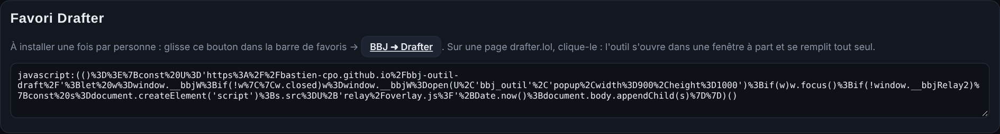
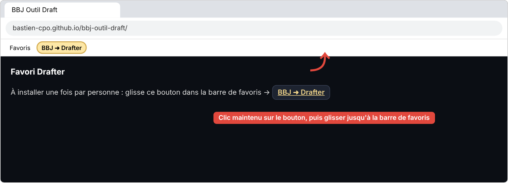
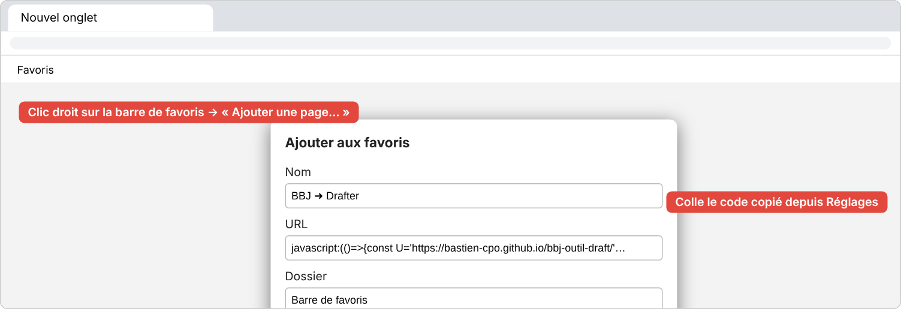
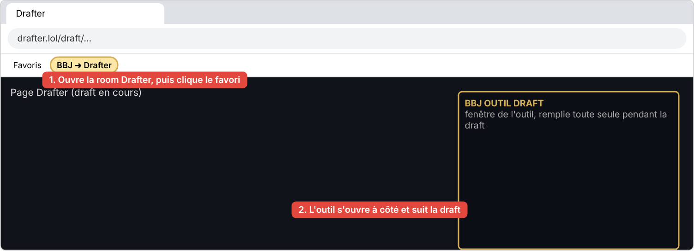

# Installer le favori « BBJ ➜ Drafter »

Le favori relie **Drafter** à l'outil. Une fois cliqué sur la page Drafter, l'outil s'ouvre dans une fenêtre à côté et **lit la draft en direct** (bans, picks, game suivante). Plus besoin de recopier quoi que ce soit.

**À faire une seule fois, sur ton navigateur habituel (Chrome, Edge, Firefox, Opera…). Ça prend 2 minutes.**

---

## Étape 1 — Afficher la barre de favoris

Appuie sur **Ctrl + Maj + B** (sur Mac : **Cmd + Maj + B**).
La barre de favoris apparaît sous la barre d'adresse.

---

## Étape 2 — Ouvrir les Réglages de l'outil

1. Ouvre l'outil : **https://bastien-cpo.github.io/bbj-outil-draft/**
2. Clique l'onglet **Réglages**, puis descends jusqu'à **Favori Drafter**.

---

## Étape 3 — Glisser le bouton dans la barre de favoris

**Clic maintenu** sur le bouton **BBJ ➜ Drafter**, puis **glisse-le** dans la barre de favoris et relâche.

C'est fait : « BBJ ➜ Drafter » apparaît dans ta barre de favoris.

> **Si le glisser-déposer ne marche pas** (certains navigateurs le bloquent), fais-le à la main :
> 1. Dans la section Favori Drafter, clique dans le **cadre de code** sous le bouton, fais **Ctrl + A** puis **Ctrl + C**.
> 2. **Clic droit** sur la barre de favoris → **Ajouter une page…** (Chrome/Edge) ou **Ajouter un marque-page…** (Firefox).
> 3. **Nom** : `BBJ ➜ Drafter` · **URL** : colle le code (**Ctrl + V**) → **Enregistrer**.
>
> 

---

## Étape 4 — L'utiliser le jour du match

1. Ouvre la **room Drafter** (le lien envoyé avant la draft).
2. Clique **BBJ ➜ Drafter** dans ta barre de favoris.
3. L'outil s'ouvre dans une **fenêtre à côté** et se remplit tout seul pendant la draft.

- Choisis notre **côté** (Blue / Red) dans l'outil au début de chaque game.
- Quand Drafter passe à la **game suivante**, l'outil suit automatiquement.
- Si la fenêtre ne s'ouvre pas, ton navigateur bloque peut-être les fenêtres pop-up : autorise-les pour **drafter.lol**, puis clique de nouveau le favori.

---

## Problèmes fréquents

| Problème | Solution |
|---|---|
| Rien ne se passe au clic | Tu dois être **sur la page Drafter** quand tu cliques le favori, pas sur l'outil. |
| La fenêtre ne s'ouvre pas | Autorise les pop-ups pour drafter.lol (icône dans la barre d'adresse). |
| L'outil ne suit plus la draft | Clique de nouveau le favori sur la page Drafter. |
| Un pick ou un ban est faux | Clique le champion dans l'outil pour le corriger : la correction est gardée. |
