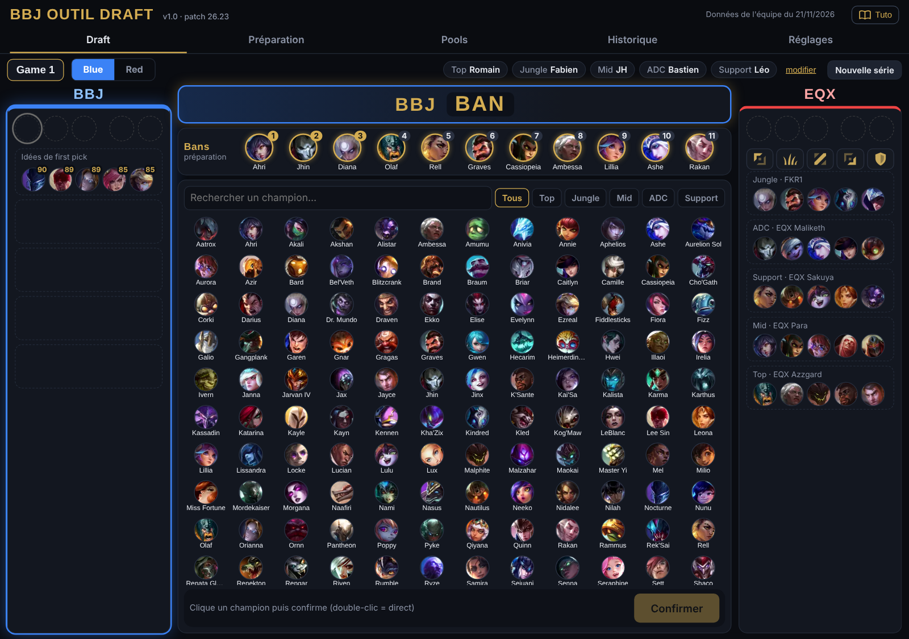
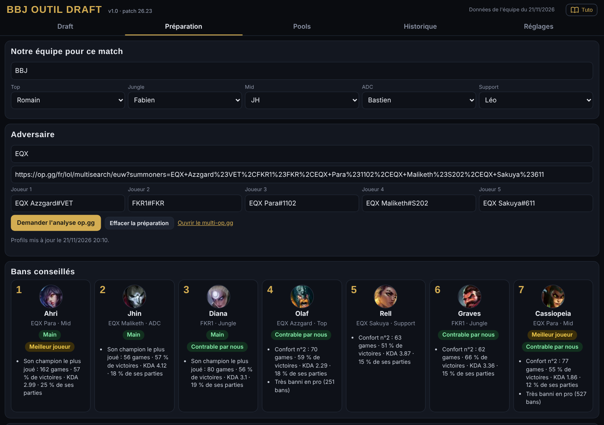

# Guide de l'outil draft BBJ

**Ouvrir l'outil :** https://bastien-cpo.github.io/bbj-outil-draft/

## C'est quoi ?

Pendant une draft de League of Legends, chaque équipe bannit puis pick ses champions à tour de rôle. Cet outil t'aide à prendre ces décisions. À chaque étape, il te propose :

- quels champions **bannir** ;
- quels champions **picker**, rôle par rôle, avec un score sur 100 ;
- ce que l'**adversaire** va probablement jouer ;
- une fois la draft terminée, une **analyse** des deux compositions.

Il est pensé pour le format **fearless** : dans une série (souvent 3 games), un champion joué dans une game ne peut plus être joué par personne dans les games suivantes. L'outil retire donc automatiquement les champions déjà joués.

Les conseils sont des propositions : la décision finale reste à l'équipe.

Tu peux t'en servir sans risque pour **t'entraîner** : lance une draft, clique des champions, regarde ce que l'outil propose. Rien n'est envoyé à qui que ce soit.

---

## Prendre en main l'outil en 2 minutes

1. Ouvre l'outil avec le lien ci-dessus. Tu arrives sur l'onglet **Draft**.
2. L'outil demande **de quel côté joue l'équipe** (Blue ou Red) : choisis.
3. Au centre, l'outil indique ce qu'il faut faire (« BBJ BAN », « BBJ PICK », etc.) et propose des champions.
4. Pour placer un champion, **clique-le dans la grille**, puis **Confirmer** (un double-clic confirme directement). **Retour** annule la dernière action.
5. Continue jusqu'aux 20 actions de la draft (10 bans, 10 picks). L'analyse finale apparaît alors.

En vrai match, il n'y a rien à cliquer : l'outil se branche sur **Drafter** (le site où se fait la draft) grâce à un favori, et se remplit tout seul. → [Installer le favori](FAVORI.md)

---

## Les 5 onglets

| Onglet | À quoi il sert |
|---|---|
| **Draft** | La draft en direct : suggestions, prédiction adverse, analyse finale |
| **Préparation** | La lineup de l'équipe et le profil des adversaires |
| **Pools** | Les champions de chaque joueur, classés par niveau (tier list) |
| **Historique** | Les séries déjà jouées |
| **Réglages** | Les paramètres du calcul et le favori Drafter |

---

## 1. L'onglet Draft

### La barre du haut
- **Game 1, 2, 3** : la game en cours dans la série.
- **Blue / Red** : le côté de notre équipe. Il change souvent d'une game à l'autre, et tout en dépend : l'ordre de la draft et les conseils.
- **La lineup** (Top Romain, Jungle Fabien…) : qui joue quel rôle. Elle se modifie dans l'onglet Préparation.
- **Nouvelle série** : range la série en cours dans l'Historique et repart à zéro.

### Les deux colonnes
- Une colonne par équipe, avec ses **bans** (petites icônes en haut) et ses **picks**.
- **Corriger une erreur** : clique sur un champion déjà placé.
- Le bouton **\*** à côté d'un pick signale un **flex** : un champion qui peut aller sur plusieurs rôles, dont on ne connaît pas encore la position.
- Pendant les bans, la colonne de notre équipe montre déjà des **idées de premier pick** (côté bleu) ou des **idées de paires** pour nos deux premiers picks (côté rouge).

### La colonne adverse : prédire leurs picks
Pour chaque rôle adverse encore libre, l'outil affiche les 5 champions qu'ils ont le plus de chances de prendre.
- Il s'appuie surtout sur **ce que chaque joueur joue en solo Q** (son op.gg), puis sur le contexte : ce qui contre nos picks, ce qui va avec leurs picks, la méta.
- Il lit aussi **leurs bans**. S'ils bannissent tout ce qui contre un champion, c'est souvent qu'ils comptent le jouer.
- Un **cercle rouge** autour d'un champion signale un pick dangereux pour nous.
- Les **icônes de rôle** au-dessus ouvrent la **fiche du joueur adverse** : ses champions favoris, ses champions partagés avec un coéquipier, et ce qu'on peut laisser passer.

### Au centre : les suggestions

**Quand c'est à nous de bannir :**
- **Bans 1 à 3** : on enlève les champions préférés des adversaires (ceux qu'ils jouent beaucoup et bien). Un champion que notre joueur sait contrer porte l'étiquette « Contrable par nous » : on peut envisager de le laisser.
- **Bans 4 et 5** : la draft est déjà entamée, donc on bannit ce qui fait le plus mal à notre composition (leurs picks probables, les counters de nos picks).
- Si l'adversaire bannit **un de nos champions qui contre l'un de leurs conforts**, ce confort remonte dans la liste : ils le préparent sans doute.

**Quand c'est à nous de picker :** une ligne par rôle encore libre, avec une note sur 100 sur chaque champion.

| Critère | Ce qu'il mesure |
|---|---|
| **Affinité** | Le joueur maîtrise-t-il ce champion ? (games en équipe, solo Q, tier list) |
| **Méta** | Le champion est-il fort en ce moment ? (games pro et solo Q haut niveau) |
| **Synergie** | Va-t-il bien avec nos picks déjà faits ? |
| **Matchup / Blind** | Gagne-t-il contre son adversaire direct ? Si on ne le connaît pas encore : peut-il être pické sans risque ? |

Les quatre critères comptent autant par défaut ; le matchup du top compte un peu plus. **Passe la souris** sur un champion pour voir le détail de sa note. La ligne **Duos** propose des paires de champions qui fonctionnent bien ensemble.

### L'analyse de fin de draft

- Une **estimation des chances de victoire**.
- Les **forces et faiblesses** de chaque composition (engage, early game, scaling…), avec leurs synergies et anti-synergies.
- Les **4 face-à-face** : top, jungle, mid et botlane, avec notre winrate. Un « ≈ » signale une estimation, faute de données sur ce duel précis.
- Un **plan de jeu**, seulement quand quelque chose est vraiment marqué (lane très gagnante ou très perdante, énorme écart d'early ou de fin de partie).
- En bas : le **résultat** (Victoire / Défaite), puis **Partie suivante** ou **Fin de série**.

---

## 2. L'onglet Préparation

- **Notre équipe** : qui joue à quel poste pour ce match. Tout l'outil s'adapte à ce choix.
- **Adversaire** : son nom, ses pseudos et son lien op.gg.
- **Bans conseillés** : la liste des bans à prévoir, par ordre de priorité, chacun avec sa raison chiffrée (nombre de games, winrate, KDA, part de ses parties).
- **Profils adverses** : les champions de chaque joueur, avec son nombre de games et son winrate.

La préparation des adversaires est faite par le responsable de l'outil (voir plus bas).

---

## 3. L'onglet Pools

- Une **tier list par joueur** : S = ses meilleurs champions, jusqu'à D. « Hors tier » regroupe les champions qu'il joue sans les avoir classés.
- Sous chaque champion, deux chiffres : **à gauche, les games en équipe** (scrims et compétition), **à droite, les games en solo Q**.
- **Clique un champion** pour ouvrir sa fiche : games, victoires et défaites, winrate, KDA, part des dégâts de l'équipe, or à 15 minutes, et une **note de performance sur 100** (50 = le niveau habituel du joueur ; au-dessus, il est meilleur que d'habitude sur ce champion).
- Dans cette fiche, les boutons **S A B C D** changent le tier du champion. Le champ en bas ajoute un champion au pool.

Les tier lists pèsent beaucoup dans les conseils de picks : plus elles sont justes, meilleurs sont les conseils.

---

## 4. L'onglet Historique

Chaque série jouée : date, adversaire, score, et pour chaque game le côté, les deux compositions et une note. Ouvre une game pour revoir sa draft et ses stats (KDA, or, CS, dégâts, objectifs).

---

## 5. L'onglet Réglages

- **Poids du score** : l'importance de chaque critère (affinité, méta, synergie, matchup).
- **Ordre des rôles en draft** : dans quel ordre l'équipe pick ses rôles en général.
- **Synergies et counters** : tu peux y ajouter ce que l'équipe sait par expérience, par exemple un matchup qu'on maîtrise.
- **Favori Drafter** : le bouton à installer (voir le [tutoriel](FAVORI.md)).

---

## Gérer l'outil pendant une série (rôle de responsable)

Pendant un match, une seule personne fait tourner l'outil : elle le relie à Drafter et l'utilise pendant la draft, puis, à la fin, envoie la série et ses stats pour toute l'équipe. Voici comment prendre ce rôle.

### Pendant la série : relier Drafter à l'outil
1. Installe le favori une fois → [tutoriel](FAVORI.md).
2. Ouvre la room Drafter, clique le favori : l'outil s'ouvre à côté et suit la draft.
3. Au début de chaque game, choisis **notre côté** (Blue / Red).
4. À la fin de chaque draft, entre le **résultat** (Victoire / Défaite) quand la game est finie.
5. Quand Drafter passe à la game suivante, l'outil suit tout seul. Sinon, clique **Partie suivante**.

### À la fin de la série : le bouton « Fin de série »
Ce bouton range la série dans l'historique. Sur un PC préparé (voir ci-dessous), il fait aussi automatiquement le reste :
1. il récupère les **parties personnalisées** de la série dans le client League of Legends de ce PC (KDA, or, CS, dégâts, objectifs) ;
2. il les associe aux drafts de l'outil ;
3. il **publie la série et ses stats en ligne** (sur GitHub). L'outil est alors à jour pour toute l'équipe, et les stats s'ajoutent aux fiches de l'onglet Pools.

Le client League of Legends doit être **ouvert et connecté sur le compte qui a joué les parties**. Le bouton récupère les parties personnalisées des 10 dernières heures.

### Préparer un PC pour « Fin de série » (une seule fois, sous Windows)
1. **Récupérer les scripts.** Dans le [dossier scripts du dépôt](https://github.com/Bastien-cpo/bbj-outil-draft/tree/main/scripts), télécharge `bbj-export.ps1` et `Installer le bouton Fin de serie.bat`. Mets-les dans un même dossier, par exemple `Documents\BBJ`.
2. **Installer le bouton.** Double-clique `Installer le bouton Fin de serie.bat`. Il relie le bouton « Fin de série » de l'outil au script. Pas besoin d'être administrateur.
3. **Obtenir l'accès en écriture.** Demande à Bastien de t'ajouter comme collaborateur du dépôt GitHub `bbj-outil-draft`, puis accepte l'invitation.
4. **Créer ta clé GitHub.** Sur github.com : ta photo → **Settings** → **Developer settings** (tout en bas à gauche) → **Personal access tokens** → **Fine-grained tokens** → **Generate new token**.
   - Repository access : **Only select repositories** → `Bastien-cpo/bbj-outil-draft`.
   - Permissions → **Contents : Read and write**.
   - Génère la clé et copie-la.
5. **Enregistrer la clé.** Dans le dossier des scripts, crée un fichier texte nommé `github-token.txt` et colles-y la clé, seule sur la ligne. **Ne la partage jamais**, pas même sur Discord.

Si quelque chose ne marche pas, le script écrit chaque étape dans `log.txt`, dans le même dossier : envoie ce fichier à Bastien.

---

## Bon à savoir
- Ce que tu changes sur le lien (tier lists, préparation, historique) reste **dans ton navigateur**. Quand la version de l'équipe est mise à jour, l'outil la récupère à la prochaine ouverture et elle remplace tes changements.
- Une draft laissée en cours depuis plus de 6 heures est effacée à l'ouverture : l'outil repart propre.
- Les données viennent de : OP.GG (méta et solo Q), 12 746 games pro 2025-2026, lolalytics et lolstats.gg (matchups), metabot.gg (synergies), et nos propres scrims.
