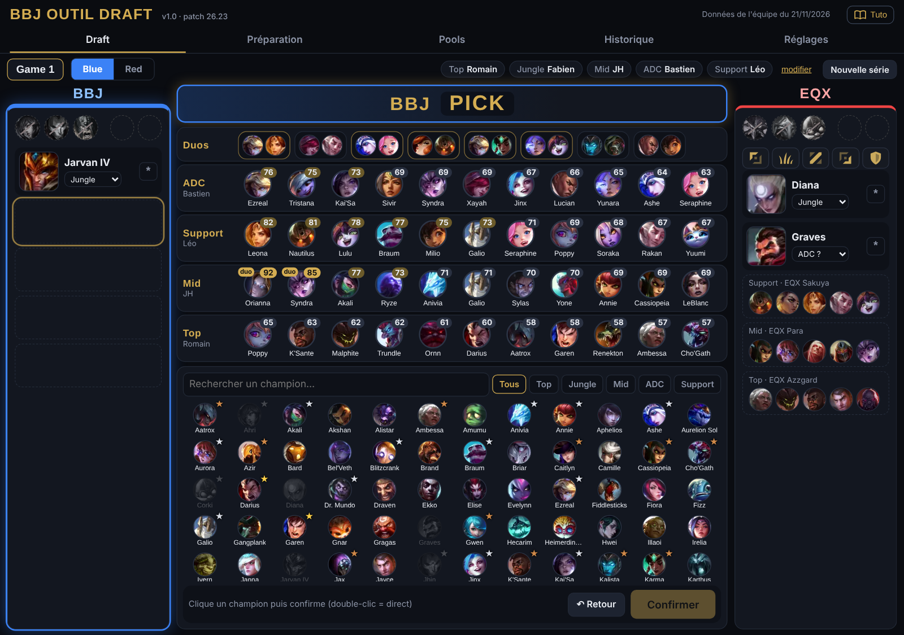
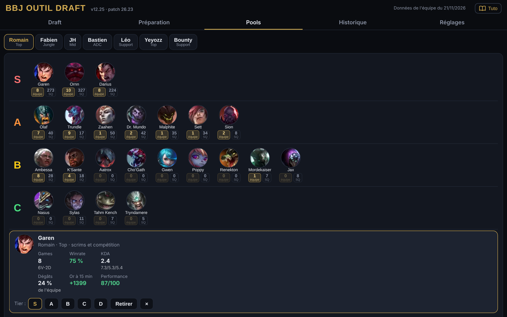

# Guide de l'outil draft BBJ — version 1.21

**Lien de l'outil :** https://bastien-cpo.github.io/bbj-outil-draft/

L'outil nous conseille pendant la draft : bans, picks, duos, prédiction des picks adverses, et une analyse quand la draft est terminée. Il est pensé pour notre format : **fearless, séries de 3 games**.

Les conseils sont des propositions, pas des ordres. La décision finale reste celle de l'équipe.

---

## En 30 secondes

1. Installe le **favori « BBJ ➜ Drafter »** une seule fois → [tutoriel du favori](FAVORI.md). C'est la seule chose à installer.
2. Le jour du match, ouvre la room **Drafter**, puis clique le favori : l'outil s'ouvre à côté et suit la draft tout seul.
3. À chaque game, choisis notre côté (Blue / Red). Ensuite, lis les suggestions au fil des étapes.
4. À la fin de la game, entre le résultat (Victoire / Défaite).

---

## Les 5 onglets

| Onglet | À quoi il sert |
|---|---|
| **Draft** | La draft en direct : suggestions de bans et de picks, prédiction adverse, analyse finale |
| **Préparation** | Notre lineup, l'adversaire, ses op.gg, les bans conseillés |
| **Pools** | Les tier lists de chaque joueur, avec nos stats en scrim |
| **Historique** | Nos séries passées : drafts, résultats, stats des games |
| **Réglages** | Poids du score, ordre des rôles, matchups et synergies, favori Drafter |

---

## 1. Onglet Draft

### En haut
- **Game 1 / 2 / 3** : la game en cours de la série.
- **Blue / Red** : notre côté. L'outil le demande à chaque game, car tout en dépend (ordre de la draft, suggestions).
- **Lineup** (Top Romain, Jungle Fabien…) : qui joue quel rôle. On la modifie dans Préparation.
- **Nouvelle série** : archive la série en cours dans l'Historique et repart à zéro.

### Les deux colonnes
- **À gauche, nous ; à droite, eux** (ou l'inverse selon le côté). On y voit les bans et les picks faits.
- Cliquer un champion déjà placé permet de **corriger** une erreur. La correction est gardée, même si Drafter renvoie autre chose.
- Le bouton **\*** à côté d'un pick = **flex** : le rôle de ce champion n'est pas encore sûr.
- Les **icônes de famille** à côté de chaque pick : ⚔ Engage, 🎯 Pick/Catch, 🛡 Réception, ☄ Poke, ⤵ Dive, ✸ Teamfight, ↯ Split, ⏳ Scaling. Sous chaque compo, un bilan montre les familles présentes et, en rouge, ce qui manque (engage, réception).
- Pendant les bans, notre premier emplacement de pick affiche des **idées de first pick** (côté bleu) ou des **idées de paires R1-R2** (côté rouge).

### La prédiction adverse (colonne adverse)
Pour chaque rôle adverse encore libre, l'outil montre les 5 champions qu'ils ont le plus de chances de jouer.
- Le calcul : **60 % leur pool** (op.gg) et **40 % le contexte** (counters de nos picks, synergies avec leurs picks, méta).
- **Leurs bans comptent aussi.** S'ils bannissent les counters d'un champion, ils le préparent sans doute. S'ils ont banni un champion à une game précédente et le laissent ouvert maintenant, ils comptent sans doute le jouer.
- Un **cercle rouge** autour d'un champion = pick dangereux pour nous (gros counter ou mécanique qui punit notre compo).
- Dès qu'on lock un champion, l'outil regarde **ce que son vis-à-vis prend d'habitude contre lui en solo Q** et le fait remonter.
- Les **icônes de rôle** au-dessus ouvrent la **fiche du joueur adverse** : son pool, ses champions flex, ce qu'il joue d'habitude contre notre pick. Elle suit la draft : un champion pické, banni ou déjà joué disparaît de la fiche.

### Au centre : les suggestions
Pendant **nos bans** :
- **Bans 1 à 3** : on vise le **confort de leurs joueurs** (volume de games, winrate, KDA). C'est notre façon de faire face à une équipe qu'on connaît peu. Si notre joueur a un vrai counter à un de leurs champions, celui-ci descend un peu, avec l'étiquette « Contrable par nous ».
- **Bans 4 et 5** : adaptés à la draft : leurs picks probables, les counters de nos picks, et leur compo : l'outil affiche sa stratégie au-dessus des bans. Soit **les priver** de ce qui leur manque (si on a de quoi punir ce manque), soit **casser leur synergie** (s'ils ne peuvent plus le combler ou si on n'a pas les outils). Les bans qui servent cette stratégie ont un **anneau bleu**.

Pendant **nos picks**, une ligne par rôle encore libre, avec un **score sur 100** sur chaque champion :

| Critère | Poids | Ce qu'il mesure |
|---|---|---|
| **Affinité** | 25 | Expérience du joueur : games en scrim/compétition, solo Q, tier list |
| **Méta** | 25 | Force sur le patch (games pro + solo Q haut elo) |
| **Synergie** | 25 | Avec nos picks déjà faits, duos pro et duos qu'on joue déjà |
| **Matchup / Blind** | 25 | Contre son vis-à-vis s'il est connu ; sinon, capacité à être pické à l'aveugle |

- Le **top** compte un peu plus dans le matchup (×1,35) : à notre niveau, sa lane pèse beaucoup.
- À partir de nos 3 premiers picks, un bandeau indique ce qui **manque à notre compo** (engage, réception) : les champions qui le combleraient ont un **anneau bleu**, y compris 2 champions « hors pool » forts dans la draft, à proposer au joueur. Un **anneau vert** signale un champion qui punit la compo adverse (par exemple du dive contre une compo sans réception). La ligne **Duos** propose les paires qui marchent ensemble. Elle ne propose jamais deux champions qui perdent ensemble.
- Passer la souris sur un champion affiche le **détail du score**.
- En **fearless**, les champions déjà joués dans la série disparaissent des suggestions.

### Choisir un champion à la main
Clique le champion dans la grille, puis **Confirmer**. Un double-clic confirme directement. **Retour** annule la dernière action.

### L'analyse de fin de draft

- **% de victoire estimé** (expérience, matchups, cohérence de compo, méta).
- **Forces et faiblesses** de chaque compo, avec les synergies et anti-synergies.
- Les **4 matchups** : top, jungle, mid, botlane. Un « ≈ » signifie une estimation (pas de duel mesuré dans nos données).
- Le **plan de jeu** : il n'apparaît que quand quelque chose est vraiment marqué (lane très gagnante ou perdante, gros écart d'early ou de scaling…).
- **Builds adaptés à la draft** (cadre repliable) : pour nos 5 champions, l'ordre d'items conseillé pour cette game. On part du build le plus joué du patch, puis on l'ajuste selon leur compo. Les items en **vert** sont ceux qui ont été ajoutés ou avancés, avec la raison en dessous :
  - **soins forts** en face (Vladimir, Mundo, Warwick…) : anti-soin obligatoire chez 2 joueurs, composant dès le 1er retour ;
  - **2 tanks ou plus** : pénétration plus tôt (Dominik, Black Cleaver, Void Staff…) ;
  - **3 corps à corps ou plus** : Runaan's à la place de l'item de vitesse d'attaque pour les ADC qui l'utilisent ;
  - **leur plan = engage / dive / assassins** : défensif plus tôt chez nos carries (Guardian Angel, Shieldbow, Zhonya, Mikael's…) ;
  - **carries critiques** en face : Randuin's chez nos tanks et supports tank ;
  - beaucoup de **dégâts magiques**, de **boucliers** ou une **suppression** : résistance magique, Serpent's Fang, Mercurial ; les bottes des tanks et bruisers suivent aussi (Steelcaps ou Mercury's).

  Ce sont des repères, pas des obligations : l'état de la partie compte plus.
- **Résultat** : Victoire / Défaite. **Partie suivante** sert seulement si l'outil ne suit pas tout seul ; **Fin de série**, c'est moi qui m'en occupe.

---

## 2. Onglet Préparation

- **Notre équipe** : qui joue quel rôle. Si un remplaçant joue, change-le ici : tout l'outil s'adapte.
- **Adversaire** : nom, lien multi-op.gg, pseudos (avec le #TAG).
- **Demander l'analyse op.gg** : c'est moi qui prépare les profils et les bans conseillés. Si tu as le multi-op.gg d'une équipe, envoie-le-moi sur Discord.
- **Bans conseillés** : par ordre de priorité, chacun avec sa raison chiffrée (games, winrate, KDA, part de ses parties).
- **Profils adverses** : les champions de chaque joueur, avec ses games et son winrate.
- **Saisie manuelle** : pour entrer un pool à la main si besoin.

---

## 3. Onglet Pools

- Une tier list par joueur (S, A, B, C, D, puis « Hors tier »).
- Sous chaque champion : **à gauche, les games en équipe** (scrims + compétition), **à droite, la solo Q** (tous nos comptes).
- **Clique un champion** pour ouvrir sa fiche : games, victoires/défaites, winrate, KDA, part des dégâts, or à 15 min et **note de performance /100**. Les boutons pour **changer son tier** sont dans la même fiche.
- La note de performance : **50 = ton niveau habituel à ce rôle**. Le winrate compte pour moitié, puis KDA, dégâts, or à 15 min et écart de CS.
- Le champ en bas sert à ajouter un champion à un pool.

Les tier lists comptent beaucoup dans les suggestions : **tenez-les à jour**.

---

## 4. Onglet Historique

Chaque série jouée : date, adversaire, score, et pour chaque game notre côté, les deux compos et une note. On peut ouvrir une game pour revoir la draft et les stats (KDA, or, CS, dégâts, objectifs).

---

## 5. Onglet Réglages

- **Poids du score** (25 / 25 / 25 / 25 par défaut).
- **Ordre des rôles en draft** : le rôle qu'on pick le plus tôt, jusqu'au plus tard.
- **Synergies** et **Counters** : on peut ajouter les nôtres à la main (par exemple un matchup qu'on connaît bien en équipe).
- **Favori Drafter** : le bouton à glisser dans la barre de favoris.

---

## Remplacer Bastien pendant une série

Si je ne suis pas là, l'un de vous fait tourner l'outil pendant la draft. Rien à installer à part le favori.

1. Ouvre la room Drafter et clique le favori **BBJ ➜ Drafter** : l'outil s'ouvre et suit la draft.
2. Vérifie la lineup dans **Préparation** (surtout si un remplaçant joue).
3. Au début de chaque game, choisis notre côté (Blue / Red).
4. À la fin de chaque game, entre le résultat (Victoire / Défaite). L'outil passe tout seul à la game suivante quand Drafter change de game. Si la pastille « ● BBJ synchro » n'apparaît pas sur la page Drafter de la nouvelle game, reclique le favori sur cette page : une nouvelle fenêtre de l'outil reprend la série et l'ancienne se ferme.
5. **À la fin de la série, ne clique pas sur « Fin de série »** : envoie-moi simplement le **lien de la room Drafter** sur Discord.

Je m'occupe ensuite de récupérer la série et les stats des games depuis mon PC : elles arriveront dans l'Historique et dans les fiches de l'onglet Pools pour toute l'équipe.

**Bon à savoir :** ce que tu modifies sur le lien (tiers, préparation, historique) reste **dans ton navigateur**. Quand je publie une mise à jour, l'outil la récupère à la prochaine ouverture et remplace tes modifications. Pour changer une tier list pour toute l'équipe, envoie-moi tes changements.

---

## D'où viennent les données
- **Méta** : OP.GG Maître+ et Émeraude+, patch 26.22 ajusté avec le patch 26.23.
- **Pro** : 12 746 games pro 2025-2026 (ordre de pick, duos joués ensemble).
- **Matchups** : lolalytics Maître+, complétés par lolstats.gg. **Synergies** : lolstats.gg et metabot.gg.
- **Nos games** : Parthénon (72 scrims jusqu'au 17/11), puis chaque série exportée avec « Fin de série ».
- **Solo Q** : op.gg, tous les comptes de chaque joueur.
- **Builds de base** : OP.GG patch 16.23 (Émeraude+), le core le plus joué de chaque champion de nos pools, relevé le 28/11. Les ajustements selon la compo sont des règles écrites à la main (à corriger avec vos retours).
